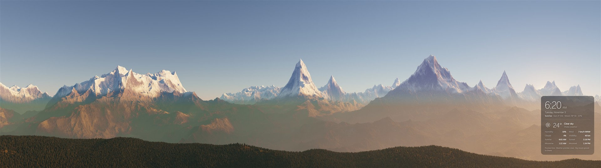
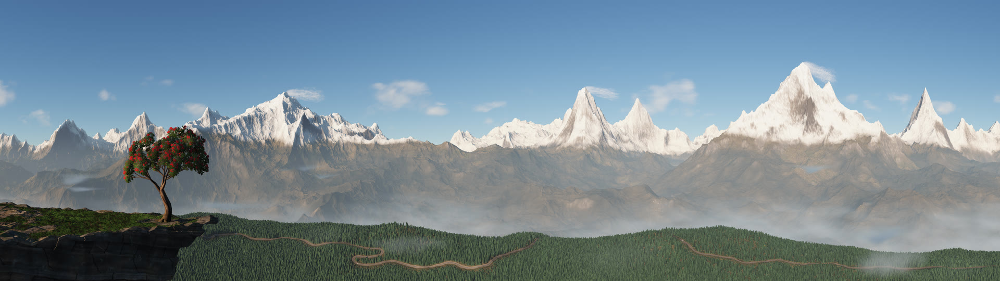
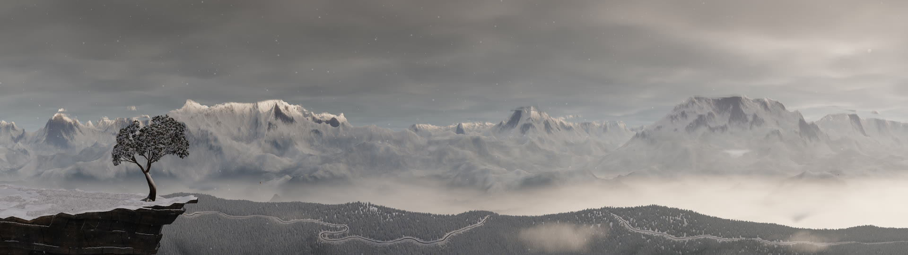
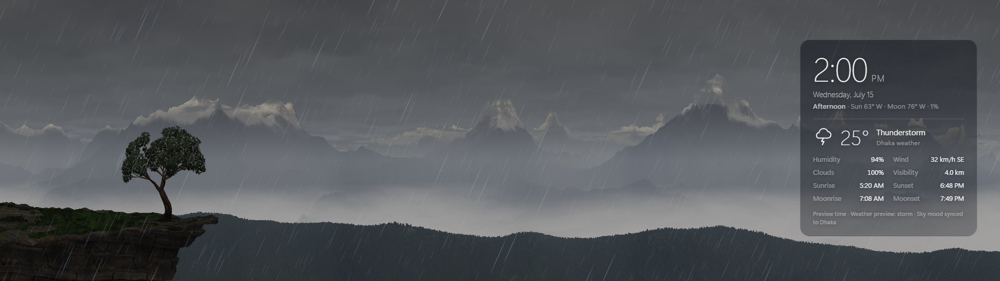
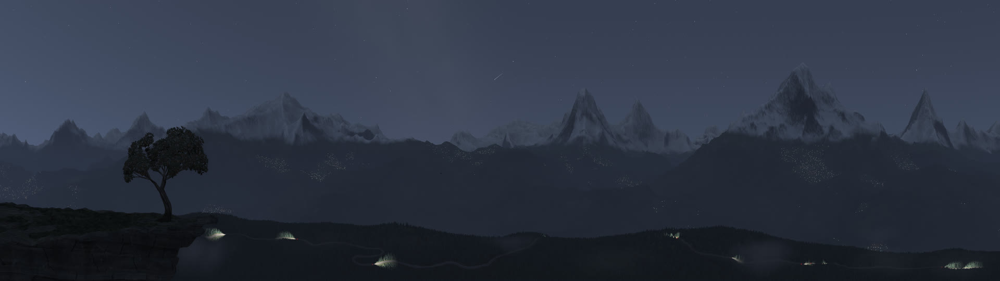
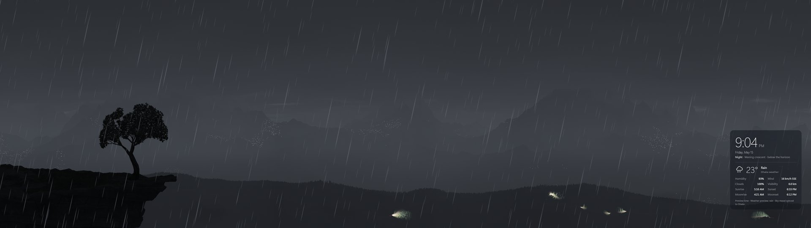

# Living Earth Himalaya: Free Live Wallpaper for Windows

<p align="center">
  <a href="https://github.com/khanRafaat/living-earth-himalaya-windows-live-wallpaper/releases/latest"></a>
  <a href="https://github.com/khanRafaat/living-earth-himalaya-windows-live-wallpaper/releases"></a>
  <a href="https://github.com/khanRafaat/living-earth-himalaya-windows-live-wallpaper/stargazers"></a>
  <a href="https://khanrafaat.github.io/living-earth-himalaya-windows-live-wallpaper/"></a>
  <a href="https://github.com/khanRafaat/living-earth-himalaya-windows-live-wallpaper/issues"></a>
  <a href="https://github.com/khanRafaat/living-earth-himalaya-windows-live-wallpaper/blob/main/LICENSE"></a>
  <a href="https://github.com/khanRafaat/living-earth-himalaya-windows-live-wallpaper#download-and-set-your-wallpaper"></a>
  <a href="https://hits.sh/github.com/khanRafaat/living-earth-himalaya-windows-live-wallpaper/"></a>
</p>

**One small exe, nothing else to install.** Living Earth Himalaya is a free, open source live wallpaper for Windows. Double-click it and your desktop becomes a real-time Himalayan mountain panorama, where the sun, moon, stars, clouds, wind, rain and snow follow the real sky and your local weather. It works on one monitor and spans dual monitors (3840 × 1080).

You do not need Lively, Wallpaper Engine, Steam, an installer, admin rights or an account.


<sub>A few hours of each season, sped up. On your desktop it all happens in real time, with your sky and your weather. To see a whole year in two minutes, right-click the tray icon and choose **Play the demo**.</sub>

## Download and set your wallpaper

### **[Download LivingEarthHimalaya-2.2.1.exe](https://github.com/khanRafaat/living-earth-himalaya-windows-live-wallpaper/releases/download/v2.2.1/LivingEarthHimalaya-2.2.1.exe)**

About 2.4 MB. For Windows 11 version 24H2 or later.

1. **Download the exe** and move it somewhere it can stay, such as your Documents folder. "Start with Windows" remembers where it is.
2. **Double-click it.** There is nothing to install. If Windows shows "Windows protected your PC", click **More info**, then **Run anyway**.
3. **Choose your options and click Set wallpaper.** Pick your location, when it should animate, what is in the scene, the clock and weather panel, the quality, what draws it, and whether to start with Windows.

The mountains now sit behind your desktop icons like a normal wallpaper, with a small icon in the system tray. The first start prepares the graphics and shapes the mountains, which can take a few minutes. Later starts take about 15 seconds.

**Not sure which Windows you have?** Press **Win + R**, type `winver` and press Enter. If your version is older than 24H2, the app tells you so. Use [Lively](#option-2-lively-wallpaper-for-windows-10-and-older-windows-11) instead.

**Why does Windows warn you?** The app is not code-signed, because a signing certificate costs money every year. If you would rather not click through the warning, read the source and build it yourself with `host\build.cmd`. Each release lists the file's SHA-256 checksum.

### Using the app

| To do this | Do this |
|---|---|
| Change settings | Double-click the tray icon. |
| Pause it | Right-click the tray icon and choose **Pause (keep the current picture)**. |
| See a whole year in two minutes | Right-click the tray icon and choose **Play the demo: a year in two minutes** (or click **Watch the demo** in the settings window). Every month plays in turn, with its weather and what goes on then. Choose it again to go back to the real time and weather. Good for showing it to someone or filming it. |
| See the version and who made it | Right-click the tray icon and choose **About Living Earth Himalaya**. |
| Go back to your normal wallpaper | Right-click the tray icon and choose **Exit (back to the normal wallpaper)**. |
| Remove it | Turn off **Start with Windows** in the tray menu and exit. Then delete the exe and the folder `%LOCALAPPDATA%\LivingEarth`. |

| Setting | What it does |
|---|---|
| Location | Found automatically, or choose a place by name or by latitude and longitude. It sets the sun, moon and weather. |
| Wallpaper mode | **Animate while you look at the desktop** is the lightest. **Animate unless a window is maximized or full screen** moves more often. **Paused** keeps a still picture. In the first two, it keeps moving gently while you work and is never behind the real sky when you come back. |
| In the scene | Turn each part on or off: the road and its traffic (light, normal or busy), the tree on the rock, flying leaves, birds, shooting stars, village lights, forest mist, clouds on the peaks, village smoke and burning fields. Changing the road shapes the mountains again, which takes a few minutes. |
| Clock and weather panel | Show it or hide it, and choose its corner and size. |
| Quality | **Auto** adjusts to your graphics. **Eco** is the lightest, then **Balanced** and **High**. **Ultra** is for powerful graphics only. |
| Draw with | **Automatic** looks at your PC: a graphics card draws at full speed; graphics built into the processor (such as Intel UHD) get at most a quarter of the chip's time, so the desktop and your apps stay smooth; with no graphics chip, the processor draws. **Graphics chip (GPU)** always uses the graphics chip, with up to half its time. **Processor (CPU)** leaves the graphics chip free: the picture is softer, the clouds change more slowly, it uses at most a quarter of the processor, and the first picture takes longer after each start. |
| Start with Windows | Starts the wallpaper when you sign in, with no window to click through. |
| Show the scene in Windows Settings too | Also sets a still picture of the scene, matching the time of day, as the Windows desktop background, so Settings > Personalization shows it. Your previous background comes back when you exit. |

### What the app uses

The exe is the only thing you download. It draws through Microsoft Edge, which is already part of Windows 11, in its own separate profile, so your browser and its tabs are not touched. It keeps its settings and saved files in `%LOCALAPPDATA%\LivingEarth`.

## Other ways to run it

You only need these if the app can't run on your Windows, or if you want to work on the code.

### Option 2: Lively Wallpaper (for Windows 10 and older Windows 11)

On these versions of Windows the app can't put itself behind the desktop icons, so the free [Lively Wallpaper](https://github.com/rocksdanister/lively) app does that part.

1. Install **Lively Wallpaper** from the Microsoft Store (free) and open it once.
2. Download **[LivingEarthHimalaya-Lively.zip](https://github.com/khanRafaat/living-earth-himalaya-windows-live-wallpaper/releases/latest/download/LivingEarthHimalaya-Lively.zip)**. In Lively, click **+** (Add wallpaper) and choose the zip.
3. For two monitors, open the monitor selector at the top of the Lively library and choose **Span**, not "Per screen" or "Duplicate". Then click Living Earth Himalaya.
4. Recommended: Lively → **Settings** → **General** → turn on **Start with Windows**. Then under **Performance**, set *When another app is fullscreen / maximised* to **Pause**.

Lively offers more settings. Right-click the wallpaper and choose **Customise**:

| Setting | What it does |
|---|---|
| Show information panel / position / size | Clock, date, phase of day, live sun and moon position, local weather, sunrise, sunset, moonrise and moonset. Put it on either monitor, small, medium or large. |
| Frame rate limit | 30 fps is smooth and light. 24 fps saves more power. |
| Save power when the scene is calm | On by default. With no rain or snow, it redraws the land and sky about twice a second and fades between the pictures, while the tree and birds keep moving. |
| Quality | **Auto** adapts to your graphics chip. Choose **Eco** if the PC feels busy, **High/Ultra** for richer clouds. |
| Render resolution | Lower it (85% / 75%) if Auto still struggles. |
| Looking toward | Which part of the real sky the panorama shows. **North-east** is the default: the real sunrise appears behind the peaks on the right screen. **South** and **West** show other parts of the day. |
| Landscape variation | A different mountain range (1 is the tuned default). |
| Cloud and mist speed | **1 = the real wind speed** (default). Higher values are a time-lapse. |
| Wind in the trees | **1 = natural** (default), up to 3 for stronger, 0 for off. |
| Wildlife and village life | Birds, smoke, village lights, shooting stars and satellites. Untick for a quieter scene, or turn each one off on its own below it, with the tree, flying leaves, forest mist and burning fields. |
| Road and traffic / how much | The mountain road with buses, jeeps and motorcycles, light, normal or busy. Changing it shapes the mountains again, which takes a few minutes. |
| Weather | **Live** normally. The *Preview* options show rain, fog, storms and so on when you want them, and the panel labels them as previews. |
| Demo: 24-hour time-lapse | Plays a full day in two minutes. Turn it off for real time. |
| Use Windows location | Uses your PC's location if Windows allows it. Otherwise it uses Dhaka. |
| Fetch weather now | Refreshes immediately instead of waiting for the 15-minute cycle. |

### Option 3: From the source code

Download the **[full source code (zip)](https://github.com/khanRafaat/living-earth-himalaya-windows-live-wallpaper/archive/refs/heads/main.zip)**. There is nothing to build. Double-click `host\LivingEarthHost.exe` to use it as your wallpaper, or open `index.html` in Chrome or Edge to watch it in a browser tab.

All versions are listed on the [releases page](https://github.com/khanRafaat/living-earth-himalaya-windows-live-wallpaper/releases). There is also a [project website](https://khanrafaat.github.io/living-earth-himalaya-windows-live-wallpaper/).

## Two monitors

In Windows **Display settings**, choose **Extend these displays**, put the monitors in the same order as on your desk, line up their top edges, and give both the same scale. The app then spans both screens by itself, and turns the view a little so that the gap between the monitors falls on a low ridge instead of the middle of a great peak.

## System requirements

| | |
|---|---|
| **Windows** | Windows 11 version 24H2 or later for the app. Windows 10 and older Windows 11 through [Lively](#option-2-lively-wallpaper-for-windows-10-and-older-windows-11). |
| **Other software** | None to install. The app uses Microsoft Edge, which comes with Windows 11. |
| **Graphics** | Any graphics chip with WebGL 2. A dedicated graphics card is not needed. If the PC has both, the wallpaper asks for the dedicated one. Without one, **Draw with: Processor** draws on the processor instead. |
| **Screens** | One or two. Designed for 1920 × 1080 each (3840 × 1080 together). Other sizes adapt. |
| **Internet** | Optional. Used for live weather and finding your location. Without it, the wallpaper uses the last saved forecast. |

**Tested on:** Windows 11, Intel Core i3-12100, Intel UHD Graphics 730 (integrated), 16 GB of memory, two 1920 × 1080 monitors. Weaker graphics chips have not been tested. If yours struggles, set Quality to **Eco**.

## Features



- **Light follows the real sky.** The sun and moon are calculated for your location and your PC clock, so sunrise, golden hour, sunset, blue hour and night happen at the true times. The moon shows its real phase, and the stars turn around the pole through the night.
- **Real positions only.** The sun and moon are drawn exactly where they really are. When they are out of view you still see their light, such as pink alpenglow or moonlit snow, but nothing is faked into view.
- **Weather follows your location.** Live data from [Open-Meteo](https://open-meteo.com/) (free, no key) sets the mood of the mountain sky: cloud cover, rain, storms, fog, mist and wind. The panel always names the place, so it is not presented as Himalayan weather.
- **Clouds move with the real wind.** Low, middle and high cloud each follow the live wind at their own height and at true speed.
- **Banner clouds on the peaks.** On humid, windy days a cloud streams from the top of the highest summits, the way real "cloud factories" form in the lee of a peak. Each streams downwind with the real wind at that height, forms and fades on its own rhythm, and is lit by the sun like the rest of the sky.
- **Weather changes play out naturally.** Clouds build first and then the rain starts. Rain stops before the sky clears. A change arrives from the side the wind is coming from.
- **Wind in the trees.** Gusts travel across the forest and meadows in the real wind direction. A tree rhododendron on the cliff edge moves with the live wind speed and direction, gets wet in rain, turns white in snow, changes colour with the season and flowers red in spring. Its fallen leaves drift past on the wind. Where it really snows, snow settles on the tree, the rock and the hills within a quarter of an hour. Snow only falls when the weather at your location says so: in a warm country such as Bangladesh it never does, while the highest summits keep their snow all year, as the real Himalaya does.
- **A mountain road with traffic.** Buses, jeeps and motorcycles wind along a road through the forest. They slow for hairpins, overtake when the road ahead is clear, and stop for passengers. At night their headlights light the road and the trees ahead, with red tail lights that brighten when they brake.
- **Mist and smoke in 3D.** After rain or on humid mornings, mist lifts off the forest in soft patches and drifts with the real wind. Wood smoke rises from villages all across the valley, near and far, and drifts downwind as a thin blue-grey haze. Each village keeps its own hours: fires are lit one after another around breakfast and supper, die down slowly, and some keep a fire in all day. On a calm morning the smoke lies in flat layers; in the afternoon sun it climbs and thins out. Now and then a field burns on a hill, its smoke glowing from below at night.
- **Wildlife and village life,** following the real clock, season and weather:
  - Vultures and eagles circle in thermals on sunny, calm middays.
  - Flocks of mountain choughs swoop past the ridge after sunrise and before sunset.
  - Geese and cranes cross in V-formation during the real autumn and spring migrations.
  - Birds shelter in rain, fog, snow and storms, and roost at night.
  - Hill villages have terraced fields, with wood smoke at breakfast and dinner time and lights that come on one by one at dusk, and go off and on again through the night.
  - Shooting stars follow the real meteor-shower calendar, and satellites glide across the sky in twilight.
- **Light on your PC.** It runs at below-normal priority and can rest whenever a window is in front. It redraws the land and sky about twice a second and fades between the pictures, while the tree, the birds and any rain or snow keep moving at the full rate. It sends the graphics chip one frame at a time and spaces its frames to leave at least half of the chip's time for your other work, and three quarters on graphics built into the processor.
- **Works offline.** The last forecast is saved, and the panel tells you what it is using.
- **A demo of the whole year.** A year in two minutes, over and over, for showing it off or filming it: snow on the tree in January, sunrise on fresh snow, spring blossom with banner clouds, a starry night with meteors, fog lifting from the valleys, the monsoon's thunder and rain, harvest fires, the Orionid meteors and snow at dusk in December.
- **Gentle with your PC.** At sign-in it waits until Windows has settled before it starts. While the PC is locked, asleep or just woken, it draws nothing at all.

<p>
  
  
  
  
</p>



## Frequently asked questions

### How do I get a live wallpaper on Windows 11?
On Windows 11 version 24H2 or later, download `LivingEarthHimalaya-2.2.1.exe`, double-click it and click **Set wallpaper**. It sits behind your desktop icons like a normal wallpaper.

### Do I need Lively or Wallpaper Engine?
No. The exe sets the wallpaper by itself on Windows 11 version 24H2 or later, with nothing else to install. Lively is only for older versions of Windows.

### Does it work on Windows 10?
Yes, through the [Lively download](#option-2-lively-wallpaper-for-windows-10-and-older-windows-11). The free Lively Wallpaper app handles the part that puts it behind your icons. The exe needs Windows 11 version 24H2 or later and tells you so if your version is older.

### Is it free?
Yes. It has no ads, no account and no paid version. The source code is under the MIT licence.

### Will a live wallpaper slow down my PC?
It uses your graphics chip while it animates, and it is built to stay out of the way of your other work. Choose **Animate while you look at the desktop** and it does the least while a window is in front. If it still feels heavy, set Quality to **Eco**.

### Does it work with two monitors?
Yes. It was designed for a dual monitor desktop, as one 3840 × 1080 panorama across both screens. It also works on a single monitor.

### What does it send over the internet?
It asks [Open-Meteo](https://open-meteo.com/) for the weather at your location, and the app can look up where you are. It has no accounts, no ads and no tracking. See [Privacy](#privacy).

### Can I use the code in my own project?
Yes. The MIT licence allows it, including commercially, as long as the copyright and licence notice stay with it.

## Privacy

The wallpaper needs a rough location for the sun, moon and weather. You can choose it by hand, or let it be found automatically. That location goes to the services below and nowhere else. There are no accounts, no ads and no analytics.

- [Open-Meteo](https://open-meteo.com/): the weather forecast, and the app's place-name search.
- [ipwho.is](https://ipwho.is/): the app's automatic location, based on your IP address, only when Windows location gives no answer.
- [OpenStreetMap Nominatim](https://nominatim.openstreetmap.org/): the name of the place at a position, in the app.

## If something looks wrong

| Problem | Fix |
|---|---|
| "Windows protected your PC" | Click **More info**, then **Run anyway**. See [why Windows warns you](#download-and-set-your-wallpaper). |
| The app says it needs Windows 11 version 24H2 | Your Windows is older. Update Windows, or use [Lively](#option-2-lively-wallpaper-for-windows-10-and-older-windows-11). |
| "Microsoft Edge was not found" | The app draws through Edge. Install Microsoft Edge again, then restart the app. |
| "Microsoft Edge closed right after it opened" | Click **Set wallpaper** to try again. If it keeps happening, [open an issue](https://github.com/khanRafaat/living-earth-himalaya-windows-live-wallpaper/issues) with the file `%LOCALAPPDATA%\LivingEarth\host.log` (it names the place you chose). |
| The same picture on both screens | Choose **Extend these displays** in Windows Display settings. In Lively, also choose **Span**, not "Duplicate" or "Per screen". |
| A strip is cut off or not aligned | Align the top edges of the monitors in Windows Display settings. |
| Black screen with an error message | Update your graphics driver, then restart the wallpaper. |
| PC feels slow | Use the lightest wallpaper mode, then set Quality to **Eco**. Keep **Draw with** on **Automatic**, or choose **Processor** to leave the graphics chip to your other apps. |
| Long "Preparing the renderer…" | Normal on the very first start and after a graphics-driver or Edge update. The shaders are being compiled. Later starts are quick. |
| Panel says "Offline" | There is no internet, so it is using the saved forecast. It updates by itself when you are back online. |
| No birds | Normal at night, in rain, fog or storms, and between visits. Flocks come and go every few minutes. |
| No sun or moon on screen | Normal when they are below the horizon or in a part of the sky that isn't in view. They are never faked. |

Something else? [Open an issue](https://github.com/khanRafaat/living-earth-himalaya-windows-live-wallpaper/issues).

## For developers

The wallpaper is a custom WebGL 2 renderer with no dependencies and no build step, written in plain JavaScript and GLSL. It runs straight from disk under `file://`. See [docs/ARCHITECTURE.md](docs/ARCHITECTURE.md) for how it works and why.

Open `index.html` in Chrome or Edge, and add settings to the address to preview a scene:

```
index.html?time=17:20                 a fixed time (sunset)
index.html?time=06:05&weather=fog     sunrise over a sea of fog
index.html?weather=storm              thunderstorm preview
index.html?date=2026-07-15            another season
index.html?timelapse=720              24 hours in 2 minutes
index.html?windtest=1                 try any wind speed and direction on the tree, live
index.html?debug=1                    a test panel: a slider for time, season, weather, wind, quality and more, plus live numbers
index.html?quality=eco&fps=24         force a quality level
index.html?calm=0                     draw the whole scene in every frame
index.html?device=cpu                 the settings used when the processor draws (start Edge with --use-angle=d3d11-warp)
index.html?gpushare=0.25              take at most a quarter of the graphics chip's time
```

Weather names: `clear, partly, overcast, rain, heavyrain, storm, fog, snow`.

```
index.html               page + information panel
host/                    the Windows app (C#), built with the compiler that ships with Windows
LivelyInfo.json          Lively metadata
LivelyProperties.json    Lively "Customise" options
src/config.js            all defaults in one place
src/services/            clock, location, astronomy, weather (no rendering code)
src/engine/              WebGL 2 renderer, shaders, environment state, quality control
src/engine/life.js       birds, road traffic, mist and smoke, meteors, satellites
src/ui/overlay.js        the information panel
docs/ARCHITECTURE.md     how the renderer works and why
tests/                   checks that run without the GPU: npm test, npm run test:browser
```

`npm start` serves it locally at http://localhost:8080. `host\build.cmd` rebuilds the Windows app, with the page inside it. `npm run zip` makes the Lively zip.

## How it was made

Living Earth Himalaya is a personal hobby project, shared as open source. Khan Rafaat Abtahe designed and planned everything: the scene, the look, the features and how it should behave. The code was written using [Claude](https://www.anthropic.com/claude) in [Claude Code](https://claude.com/claude-code).

## Author

**Khan Rafaat Abtahe**

- Website: [februne.com](https://februne.com)
- Email: [rafaatabtahe@gmail.com](mailto:rafaatabtahe@gmail.com)
- GitHub: [@khanRafaat](https://github.com/khanRafaat)

Questions, ideas and bug reports are welcome: open an issue on GitHub or send an email.

## Licence and credits

[MIT](LICENSE) © 2026 Khan Rafaat Abtahe.

Weather data: [Open-Meteo](https://open-meteo.com/) (CC BY 4.0). Sun and moon formulas adapted from SunCalc (BSD-2-Clause), with moon orbit terms from Meeus, *Astronomical Algorithms*.
